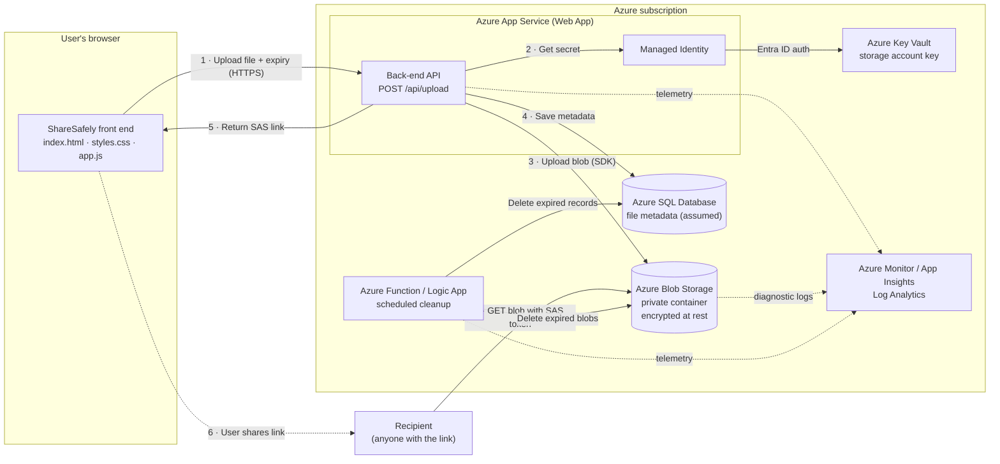
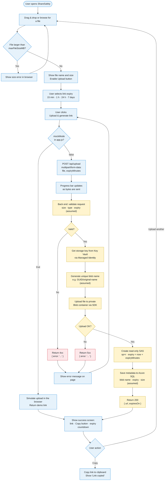
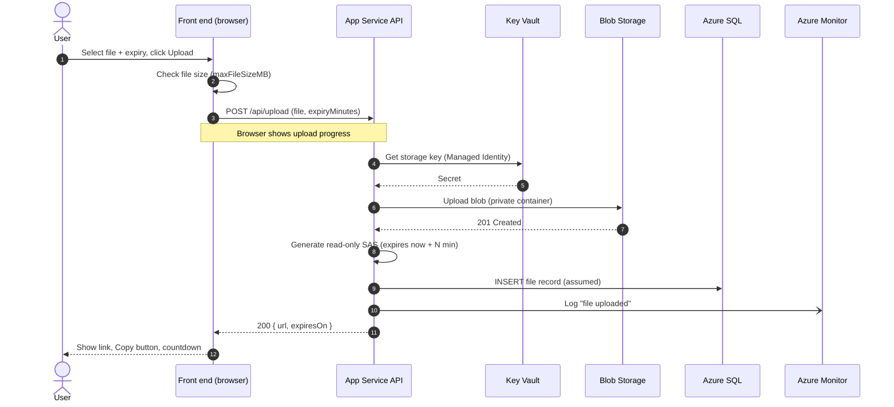
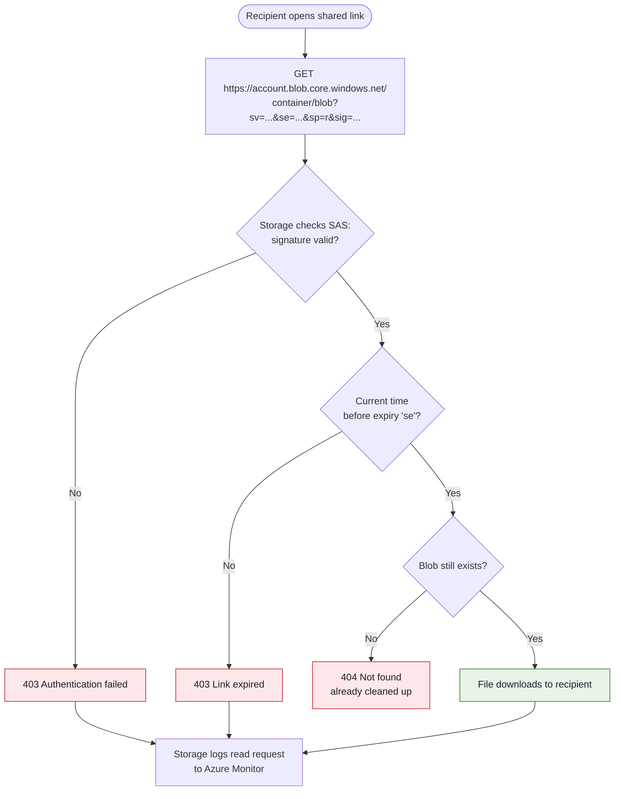
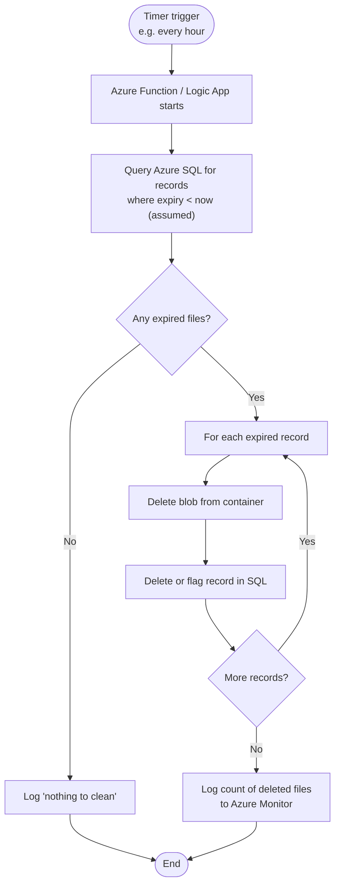
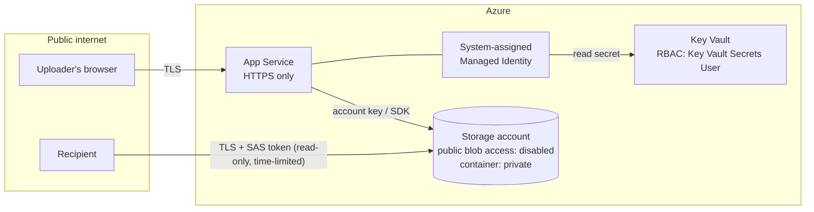

# ShareSafely – System Flow

This document describes how the system fits together, from upload through to download and cleanup.

The diagrams use [Mermaid](https://mermaid.js.org/), which GitHub, Azure DevOps and VS Code (with a Mermaid extension) display as diagrams.

**Status key**

| Component | Status |
|---|---|
| Front end (`index.html`, `styles.css`, `app.js`) | Built |
| Back end, storage, Key Vault, SQL, cleanup job, monitoring | To be built (back end owner) |

> The back-end steps follow the [ShareSafely project brief](https://github.com/madebygps/cloud-engineering-projects/blob/main/az-104/sharesafely.md). The brief doesn't define endpoints, the database schema or exactly how the links are created. Where this document fills those gaps, the step is labelled *(assumed)*.

---

## 1. Architecture overview

---

## 2. Upload flow (end to end)

**Colour key:** blue = front end (built) · yellow = back end (to build) · red = error response

---

## 3. Upload sequence (who calls whom)

---

## 4. Download flow (recipient)

The recipient downloads the file **directly from Blob Storage**. The web app isn't involved, so the SAS token in the URL is the only thing that grants access.

---

## 5. Cleanup flow (scheduled)

> **Optional:** a Blob Storage **lifecycle management** rule (for example, delete blobs older than 7 days) can act as a backstop in case the cleanup job fails.

---

## 6. Security and identity

| Control | Where | Purpose |
|---|---|---|
| HTTPS only | App Service | Encrypts uploads in transit |
| Managed Identity | App Service → Key Vault | No secrets in code or app settings |
| Key Vault | Stores the storage key | Central secret storage with rotation |
| Private container | Blob Storage | Blobs can't be read without a SAS |
| Read-only, time-limited SAS | Generated per upload | Link only allows downloads and stops working at expiry |
| Encryption at rest | Blob Storage (enabled by default) | Protects stored files |
| Size check | Front end and back end | The browser check helps users; the server check enforces the limit |
| Cleanup job | Function / Logic App | Removes files after their links expire |
| Monitoring | Azure Monitor / App Insights | Audit trail of uploads and downloads |

---

## 7. Front end ↔ back end contract

| | Detail |
|---|---|
| **Endpoint** | `POST /api/upload` (`CONFIG.uploadUrl` in `app.js`) |
| **Request** | `multipart/form-data`: `file` (binary), `expiryMinutes` (`15` · `60` · `1440` · `10080`) |
| **Success** | `2xx` + `{ "url": "<SAS URL>", "expiresOn": "<ISO 8601>" }` (`sasUrl`/`link` and `expiresAt` also accepted) |
| **Failure** | non-`2xx` + `{ "error": "<message shown to user>" }` |
| **Demo mode** | `CONFIG.mockMode = true` simulates the request in the browser. Set it to `false` for production. |
